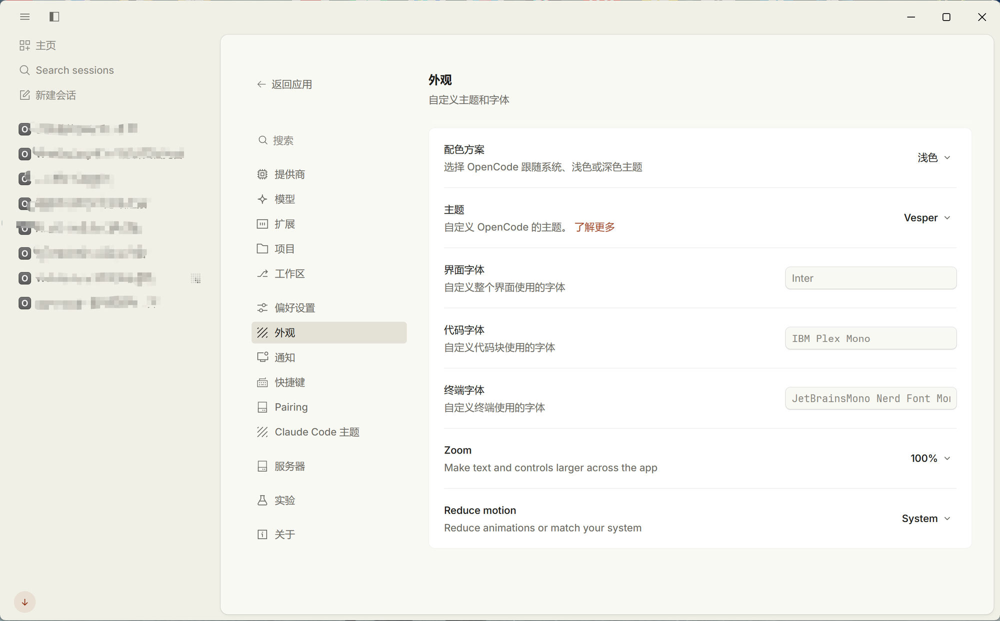

# Claude Code 主题插件 (`claude-code-theme`)

**[English](./README.md)** | **简体中文**

专为 **OpenCode Desktop V2 (`v2.2.1+`)** 与 **OpenCode TUI** 打造的 Anthropic **Claude Code / Claude.ai** 暖调人文编辑风外观主题插件。

围绕 Anthropic 标志性的 **Claude Clay（`#262624` 暖炭黑 / `#FAF9F5` 羊皮纸白 / `#D97757` 赤陶橙）** 色彩体系设计，内置 V1 + V2 双层 OKLCH 感知色彩引擎、组件级精修微样式（Micro-Styling）以及实时响应的专属设置页面。

---

## 📸 效果预览

<div align="center">
  
</div>

---

## ✨ 核心特性

1. **V1 + V2 双层 OKLCH 色彩引擎 (`L1`)**
   - 基于 OpenCode Desktop 的 OKLCH 感知色彩管线，完整生成全部 **约 260 个 V1 变量（`--background-*`、`--surface-*`、`--text-*`、`--border-*`、`--icon-*`、`--syntax-*`、`--markdown-*`）** 与 **V2 语义变量（`--bg-surface-*`、`--text-on-*`、`--border-outline-*`、`--action-fill-*`、`--palette-*`）**。
   - 通过 `:root[data-color-scheme="dark"]` 与 `:root[data-color-scheme="light"]` 自动适配桌面端的 **深色（Dark）/ 浅色（Light）/ 跟随系统（System）** 模式。

2. **4 套内置 Claude 配色预设**
   - **Claude Clay（默认赤陶暖炭）**：深色暖炭 `#262624` 与浅色羊皮纸 `#FAF9F5`，搭配经典 `#D97757` 赤陶橙强调色。
   - **Claude Slate（深墨暖石）**：深墨色 `#141413` 与暖石色 `#F0EEE6`，搭配 `#C6613F` 朱砂陶红。
   - **Editorial Parchment（人文书页）**：极具纸质阅读温润感的书页色调（`#2B2926` / `#F7F3E8`），柔和护眼。
   - **Claude Studio Crisp（高对比工作室）**：深邃黑曜石 `#111110` 与纯净白 `#FFFFFF`，强化边框与代码清晰度。

3. **5 种品牌强调色 & 3 档边框对比度**
   - **品牌强调色**：赤陶橙 Terracotta (`#D97757`)、朱砂红 Cinnabar (`#C6613F`)、牛皮纸金 Kraft Gold (`#D4A27F`)、鼠尾草绿 Sage Olive (`#A5B98C`)、无花果紫 Editorial Fig (`#D990AA`)。
   - **边框对比度**：柔和（Soft）、均衡（Balanced）、锐利（Crisp）三档可调。

4. **标志性组件级微样式精修 (`L2`)** *(支持在设置页独立开关)*
   - **底部输入框悬浮卡片化（Composer Card Polish）**：`14px` 圆角悬浮输入卡片 `[data-component="dock-prompt"]`、暖陶色聚焦光晕与赤陶色发送按钮。
   - **工具调用卡片精修（Tool Call Card Refinement）**：等宽字体参数副标题、暖色表面过渡，以及展开态工具卡片左侧的赤陶色引导线。
   - **思考 / 推理块人文导轨（Reasoning / Thinking Editorial Rail）**：为模型思考过程提供赤陶色垂直导轨与纸质暖色渐变背景。
   - **内凹终端与代码槽（Recessed Terminal & Code Wells）**：为终端输出与代码块提供深暖炭（`#1C1B1A`）/ 暖纸槽（`#F2EFE6`）内凹层次。
   - **用户消息气泡与行内代码（User Message Bubble & Inline Code）**：暖陶色微染的用户消息气泡、药丸状行内代码与人文风引用块。
   - **人文衬线标题（Editorial Serif Headings）**：可选为 Markdown 一、二级标题启用经典衬线字体（`Copernicus`、`Newsreader`、`Tiempos Text`、`Georgia`、`Songti SC`）。

5. **专属可视化设置页与命令面板 (`L4`)**
   - 在 OpenCode Desktop 左侧设置栏新增 **「Claude Code 主题」** 专属设置页面（支持全局设置搜索索引，内置简中 `zh` / 繁中 `zht` / 英文 `en` 多语言）。
   - 所有配置通过 `Store.global` 持久化保存，切换选项即时生效。
   - 注册 3 个命令面板快捷键命令（`Ctrl+Shift+P` / `Cmd+Shift+P`）：
     - `Claude Theme: Open Appearance Settings`（打开主题外观设置）
     - `Claude Theme: Toggle Enable / Disable`（一键启用 / 禁用主题）
     - `Claude Theme: Cycle Color Preset`（循环切换配色预设）

---

## 🚀 安装与配置指南

### 1. 安装 OpenCode Desktop 桌面端 GUI 插件

将本仓库克隆到本地，并将路径添加到 `~/.config/opencode/opencode.jsonc`（或 `opencode.json`）的 `plugins` 列表中：

```bash
git clone https://github.com/SunWH-howell/ClaudeTheme-for-opencode.git
```

编辑 `~/.config/opencode/opencode.jsonc`：

```jsonc
{
  "$schema": "https://opencode.ai/config.json",
  "plugins": [
    "C:/你的本地路径/ClaudeTheme-for-opencode"
  ]
}
```

重载 OpenCode 配置（执行 `opencode reload` 或重启 OpenCode Desktop），然后打开 **设置（Settings）→ Claude Code 主题**，即可实时预览并切换配色预设、强调色与各项组件微样式。

### 2. 安装独立主题 JSON（适用于 TUI 终端与原生主题选择器）

本仓库同时提供了标准主题文件 `themes/claude-clay.json`。将其复制到 `~/.config/opencode/themes/claude-clay.json` 后，即可在 TUI 终端中通过 `/theme` 选择 **Claude Clay**，或在 `~/.config/opencode/cli.json` 中设为默认主题：

```json
{
  "$schema": "https://opencode.ai/v2/cli.json",
  "theme": {
    "name": "claude-clay"
  }
}
```

---

## 📁 目录结构

```text
ClaudeTheme-for-opencode/
├── package.json              # 插件包配置（导出 ./gui-experimental -> ./dist/gui-experimental.cjs）
├── tsconfig.json             # TypeScript 配置
├── README.md                 # 英文说明文档
├── README_CN.md              # 简体中文说明文档
├── scripts/
│   └── build.mjs             # 使用 Bun 将 src/gui.ts 打包为 dist/gui-experimental.cjs
├── src/
│   ├── schema.ts             # Effect Schema 状态结构定义与预设/强调色元数据
│   ├── palettes.ts           # OKLCH 色彩算法 + V1/V2 变量生成器 + 4 套 Claude 调色板
│   ├── styles.ts             # 响应式 CSS 构建器（色彩变量 + 组件微样式 + 设置页样式）
│   ├── settings-page.ts      # 基于 Solid.js 的可视化设置页组件
│   └── gui.ts                # Plugin.define 入口（注册 Store、Style、SettingsPage、Command、i18n）
├── themes/
│   └── claude-clay.json      # 独立 OpenCode Desktop / TUI 主题 JSON 文件
└── dist/
    └── gui-experimental.cjs  # 预编译的 GUI 插件产物（克隆即用，无需手动编译）
```

---

## 🛠️ 从源码构建

如果你修改了 `src/` 下的源码，可以运行以下命令重新打包 `dist/gui-experimental.cjs`：

```bash
npm run build
# 或直接使用 Bun：
bun ./scripts/build.mjs
```

## 📄 开源协议

[MIT](./LICENSE)
